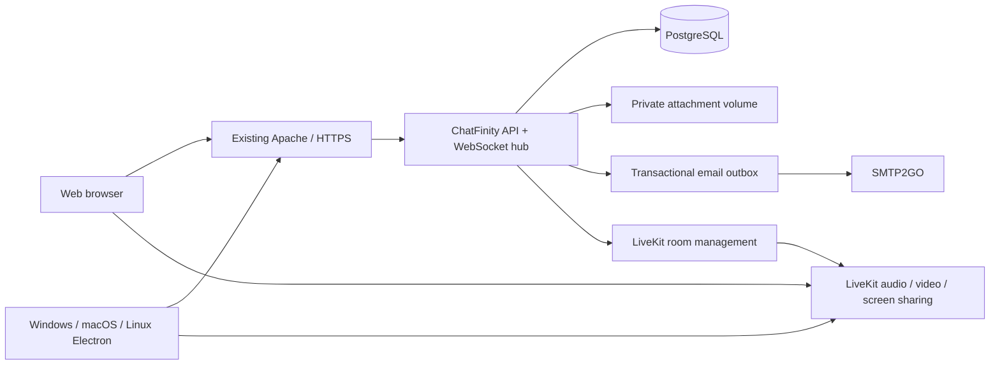

# Architecture

ChatFinity is a new repository/application. There are no imports from Perfex, no CRM cookies, no shared database tables, and no requirement for a Perfex installation.

## Components

Node.js 24/Fastify handles accounts, organization membership, permission checks, chat persistence, file access and meeting grants. React/Vite produces the web client. Electron loads the same HTTPS application in an isolated renderer, so web and desktop use one set of server APIs. PostgreSQL 17 is the production database. LiveKit carries conference media; its room API and signing secret are server-only.

## Identity and organizations

A user has one normalized, unique email and may belong to many organizations. Membership has `owner`, `admin` or `member` scope per organization. Any verified account can create an organization, subject to the initial limit of 20 created organizations per account. Organizations may have several owners; a transaction/organization lock prevents demoting or removing the last one. Only owners can delegate ownership or administrator privileges. Administrators can invite/remove ordinary members. Invitations cannot grant ownership.

Signup verifies mailbox control. Invitation acceptance is tied to the authenticated account’s exact email and also verifies that mailbox. Verification/reset/invitation secrets and session cookies are generated with cryptographic randomness; only their hashes are used for lookup. Login sessions have a 30-day lifetime, are stored in PostgreSQL and are revoked on password reset. The session cookie is HttpOnly, SameSite=Lax and Secure in production. State changes require an exact allowed Origin and session CSRF token. No CSRF bypasses or wildcard CORS policy are configured.

Passwords use salted Node scrypt hashes and timing-safe comparison. Authentication and upload/send routes have request limits; the reverse proxy must preserve genuine client addresses. This initial release has no MFA, SAML/OIDC or enterprise directory integration.

## Conversations and tenant isolation

A channel belongs to exactly one organization. Public means discoverable **within that organization**, not on the internet. Users must join before reading its messages, preview, unread count, files or meetings. Private channels are discoverable only to their members. Direct conversations have a unique normalized user-pair key within one organization. A person in two organizations gets distinct direct conversations in each.

Every sensitive HTTP endpoint checks organization/channel membership. Composite database foreign keys prevent cross-organization channel membership and cross-channel reply/attachment references. The message client identifier deduplicates a retry for the same sender; reuse in another channel is rejected. Paged history uses creation time and message ID. Search matches message text within the current accessible channel. Saved-message state is per user.

Messages carry replies, reactions and soft-deletion metadata. Author edits and author/admin removals are allowed only after current channel access is established. New-message, typing and read events go only to current members. The hub rechecks recipients against the database instead of trusting a previous socket subscription. WebSocket clients authenticate with the session cookie and exact Origin, are payload/event limited, and have periodic session and heartbeat checks. Idle active connections show away after roughly two minutes; presence is approximate.

Attachments are random-ID files outside the web bundle, never public static files. Extension/signature validation permits images/PDFs and UTF-8 text/CSV. Files are streamed into a private volume and streamed out only after authorization. The server forces attachment download with nosniff headers. Storage accounting is serialized per organization; the default limit is 1 GB. The initial allowlist intentionally excludes executable/HTML/SVG and general ZIP/Office uploads.

## Meetings

A meeting belongs to one channel and requires current channel membership. A channel has at most one active meeting. The API explicitly creates LiveKit rooms, then signs a token for the exact room and user, valid for 60 seconds. The pre-join screen refreshes the token when the user actually joins. `room.auto_create: false` prevents an issued token recreating an ended media room. End-for-everyone is authorized for the host or an administrator who is a member of that conversation. The room is deleted before the database transaction marks it ended.

The media configuration and public network path are separate from web hosting. TURN/TLS is required for broad firewall compatibility. No guest access is implemented: all participants need a verified invited/registered account and membership. WebRTC transport is encrypted, but end-to-end media encryption is not configured. Recording/transcription require a separate consent, storage, access and egress implementation.

## Desktop trust boundary

The setup screen accepts an HTTPS server root, defaulting to `https://chat.innaware.net`. Local HTTP is disabled unless an explicit development environment option is set. Remote content runs with Node integration disabled, context isolation, sandboxing and web security enabled. Navigation is restricted to the configured origin; external HTTP(S) links open in the system browser. Camera/microphone, notifications and sharing are permission-gated. Downloads use the native save dialog and are not opened automatically.

The tiny setup IPC method is accepted only from the packaged local setup frame. A remote page cannot change the trusted server through it. Switching servers clears local application cookies/cache/drafts, and the setup URL is persisted separately in Electron's private user-data directory. The desktop source includes no authentication or media secrets.

## Initial release boundaries

Implemented code is an alpha that must pass a server2 pilot before broad use. Billing, mobile native apps, push while the app is closed, auto-updating installers, platform administration dashboards, MFA/SSO, message retention enforcement, exports/e-discovery, malware scanning, enterprise quotas, recording/transcription and guest meeting rooms are not implemented. Browser notifications require a running client and user permission. A media session is not guaranteed to work behind every network until TURN/TLS is deployed and tested.

The API is deliberately single-instance initially. Horizontal scaling needs Redis/shared pub-sub, a distributed rate-limit store, shared attachment/object storage and observability. Plan capacity from actual measurements, not the configured room cap. PostgreSQL migrations beyond the initial schema will need ordered versioned changes. There is no production availability claim from a successful local test.

## Upstream references

- [Fastify support policy](https://fastify.dev/docs/latest/Reference/LTS/)
- [Electron security checklist](https://www.electronjs.org/docs/latest/tutorial/security)
- [LiveKit deployment and TURN](https://docs.livekit.io/transport/self-hosting/deployment/)
- [LiveKit ports/firewall reference](https://docs.livekit.io/transport/self-hosting/ports-firewall/)
- [LiveKit v1.13.11 sample configuration](https://github.com/livekit/livekit/blob/v1.13.11/config-sample.yaml)
